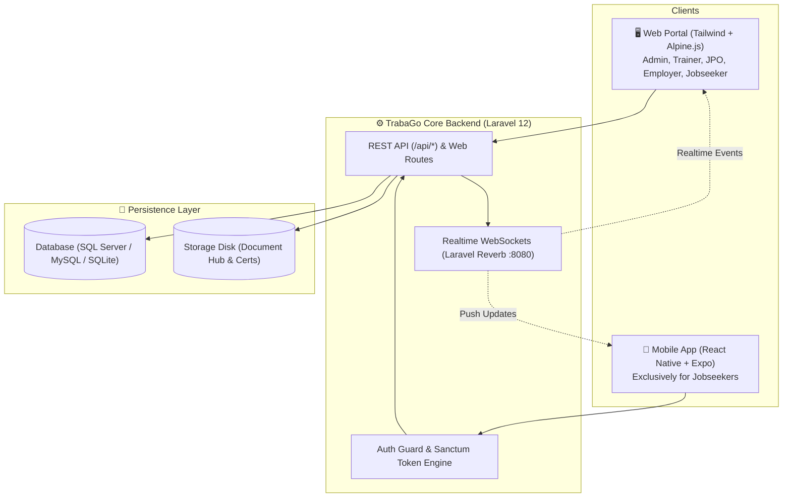

# 🌴 TrabaGo — Cebu City DMDP Employment & Skills Facilitation Platform

> **Official Integrated Digital Platform for the City Government of Cebu — Department of Manpower Development and Placement (DMDP) & Public Employment Service Office (PESO)**

---

## 📌 Project Overview

**TrabaGo** is an enterprise-grade, multi-role web platform and cross-platform mobile application built to modernize public employment facilitation, vocational skills certification, employer accreditation, and workforce placement analytics for the City Government of Cebu.

Built with a unified **Minimalist Emerald Green** design system, TrabaGo bridges Cebuano jobseekers with accredited corporate employers through AI-driven cosine skill matching, self-paced DMDP vocational training, and transparent PESO coordination.

---

## 🏛️ System Architecture & Access Model

The TrabaGo ecosystem consists of two synchronized client interfaces connected to a unified Laravel REST API backend:



> [!IMPORTANT]
> **Mobile Access Policy**: The mobile application is **strictly reserved for Jobseekers**. Administrative, verification, and facilitation roles (**Admin**, **Trainer**, **JPO**, and **Employer**) must access their portals via the **Web Application**.

---

## 🌟 Ecosystem Roles & Features

### 1. 🧑‍💼 Jobseeker Portal (Web & Mobile)
- **AI Skill-Match Engine:** Cosine-similarity matching calculates real-time candidate compatibility scores against live job vacancies.
- **National Skills Profile (NSRP Form 1):** DOLE-compliant profile with education attainment, licenses, civil service status, 4Ps beneficiary, and PWD priority placement.
- **Official Credentials Vault:** Secure multi-category storage for Resumes, Valid Government IDs, Technical Licensures, and PWD IDs.
- **DMDP Vocational Training Hub:** Direct access to course syllabi, video lectures, and in-app competency assessments.
- **Automated Digital Certificates:** Immediate issuance of verified certificates (`DMDP-CERT-YYYY-XXXXXX`) with auto-synced profile skill badges.

### 2. 👑 System Administrator Portal (Web)
- **Central Approvals Queue:** Authorize job postings, review employer accreditation packets, and inspect monthly placement reports.
- **User Account Management:** Control platform accounts, statuses, and role privileges.
- **Statistical Analytics & Audit Logs:** City-wide placement percentages, applicant influx tracking, and system audit trail.

### 3. 📋 Job Placement Officer (JPO) Portal (Web)
- **Candidate Evaluation & Referrals:** Review jobseeker qualifications and refer screened candidates directly to employers.
- **Employer Accreditation Audit:** Authenticate SEC/DTI certificates, Mayor's Permits, and BIR 2303 records.
- **Placement Monitoring:** Validate employer monthly hiring and placement logs.

### 4. 🎓 Skills Trainer Portal (Web)
- **Curriculum & Module Builder:** Author course syllabi, lesson topics, and video lecture materials.
- **Interactive Quiz Management:** Configure question banks and passing score thresholds (default: 80%).
- **Roster & Certifications:** Monitor trainee enrollment rosters, score assessments, and issue verified credentials.

### 5. 🏢 Corporate Employer Portal (Web)
- **Accreditation Pipeline:** Digital submission of legal company documentation for JPO and Admin verification.
- **Job Vacancy Management:** Post and manage job openings with disability-inclusive tagging and qualification requirements.
- **Candidate Pipeline:** Schedule candidate interviews, issue job offers, and record hires.

---

## 🛠️ Technology Stack

| Layer | Technology |
| :--- | :--- |
| **Backend Framework** | Laravel 12 / PHP 8.2+ |
| **Database** | Microsoft SQL Server (SSMS) / MySQL / SQLite |
| **API Authentication** | Laravel Sanctum & Session Guards |
| **Realtime WebSockets** | Laravel Reverb (Port 8080) |
| **Web Frontend** | Blade Components, TailwindCSS, Alpine.js, Vite |
| **Mobile App** | React Native (Expo SDK 52, Expo Router), TypeScript |

---

## 🚀 Step-by-Step Installation & Setup

### Prerequisites
Make sure your workstation has the following installed:
- **PHP** 8.2 or 8.3 with PDO, OpenSSL, and cURL extensions
- **Composer** (v2.x)
- **Node.js** (v18.x or v20.x LTS) & npm
- **Git**
- **Expo Go App** (installed on your iOS or Android phone)

---

### Step 1: Clone the Repository
```bash
git clone https://github.com/lenoj1111/TrabaGo.git
cd TrabaGo
git checkout jimmy-v2
```

---

### Step 2: Install Dependencies

#### A. Backend & Web Dependencies (Project Root):
```bash
composer install
npm install
```

#### B. Mobile Dependencies:
```bash
cd mobile
npm install
cd ..
```

---

### Step 3: Environment Configuration

#### A. Backend `.env`:
```powershell
# Windows PowerShell
Copy-Item .env.example .env

# Generate application key
php artisan key:generate
```

Open `.env` and configure your database settings:
```env
APP_NAME=TrabaGo
APP_ENV=local
APP_KEY=base64:...
APP_DEBUG=true
APP_URL=http://localhost:8000

# Database Configuration (Example: SQL Server)
DB_CONNECTION=sqlsrv
DB_HOST=localhost
DB_PORT=1433
DB_DATABASE=Trabago1
DB_USERNAME=your_username
DB_PASSWORD=your_password
DB_ENCRYPT=no
DB_TRUST_SERVER_CERTIFICATE=true

# Realtime WebSocket Configuration (Laravel Reverb)
BROADCAST_CONNECTION=reverb
REVERB_APP_ID=trabago-app
REVERB_APP_KEY=ckzj1ifqrv7u8cszy3tq
REVERB_APP_SECRET=reverb-secret-key
REVERB_HOST="localhost"
REVERB_PORT=8080
REVERB_SCHEME="http"
```

#### B. Mobile `.env`:
In `mobile/`, create `.env` from `.env.example`:
```powershell
# Windows PowerShell
Copy-Item mobile\.env.example mobile\.env
```

Open `mobile/.env` and set your computer's local IP address so physical mobile devices can connect over Wi-Fi:
```env
# Check your local IP with 'ipconfig' (e.g. 192.168.1.X)
EXPO_PUBLIC_API_URL=http://192.168.100.9:8000/api
EXPO_PUBLIC_REVERB_HOST=192.168.100.9
EXPO_PUBLIC_REVERB_PORT=8080
EXPO_PUBLIC_REVERB_KEY=ckzj1ifqrv7u8cszy3tq
```

---

### Step 4: Run Database Migrations & Seeds

```bash
# Run migrations and seed official staff accounts
php artisan migrate --seed

# Link public storage disk (critical for document vault & certificates)
php artisan storage:link
```

---

## 🖥️ Running the Platform

To run the complete system, open separate terminal windows for each service:

### Terminal 1: Laravel Backend Server
Serve on `0.0.0.0` so mobile devices on your local network can communicate with the API:
```bash
php artisan serve --host=0.0.0.0 --port=8000
```
- Web Portal URL: **`http://localhost:8000`**
- REST API Base: **`http://localhost:8000/api`**

### Terminal 2: Web Asset Compiler (Vite)
```bash
npm run dev
```

### Terminal 3: Realtime WebSockets (Laravel Reverb)
```bash
php artisan reverb:start --host=0.0.0.0 --port=8080
```

### Terminal 4: Mobile Application (Expo Go)
```bash
cd mobile
npx expo start -c
```
- **Physical Device:** Scan the terminal QR code with **Expo Go** (Android) or the native **Camera** (iOS).
- **Web Browser:** Press **`w`** in the terminal to open the mobile web preview at `http://localhost:8081`.
- **Android Emulator:** Press **`a`** in the terminal.

---

## 🔑 Official Seeded Accounts

The database seed maintains **exactly one clean account** for each administrative role. All accounts share the default password: **`password123`**

| Role | Email Address | Default Password | Authorized Interface |
| :--- | :--- | :--- | :--- |
| 👑 **System Administrator** | `admin@trabago.com` | `password123` | **Web Portal Only** (`/admin/dashboard`) |
| 🎓 **Skills Trainer** | `trainer@trabago.com` | `password123` | **Web Portal Only** (`/trainer/dashboard`) |
| 📋 **Job Placement Officer (JPO)** | `jpo@trabago.com` | `password123` | **Web Portal Only** (`/jpo/dashboard`) |
| 🧑‍💼 **Jobseeker** | *Self-registered* | *User defined* | **Mobile App** & **Web Portal** |
| 🏢 **Employer** | *Self-registered* | *User defined* | **Web Portal Only** (`/employer/homepage`) |

> [!NOTE]
> Jobseekers can register instantly via the **Mobile App** (`/auth/register`) or **Web Portal** (`/register`). Non-jobseeker roles attempting to sign into the mobile app will receive an **Access Restricted (HTTP 403)** notification.

---

## 🧪 Testing & Code Quality

Run automated test suites across backend and mobile:

```bash
# 1. Run PHPUnit test suite
php artisan test

# 2. Run Document Vault & Verification flow tests
php artisan test --filter=DocumentValidationFlowTest

# 3. Verify Mobile TypeScript compilation
cd mobile
npx tsc --noEmit
```

---

## 🛡️ Troubleshooting Checklist

1. **Mobile Cannot Reach Backend (`Network Error` / `Connection Timed Out`)**:
   - Ensure your mobile device and computer are connected to the **same Wi-Fi network**.
   - Verify that port `8000` is allowed through **Windows Defender Firewall** (`Inbound Rules -> New Rule -> Port 8000 -> Allow`).
   - Run `ipconfig` in Command Prompt to confirm your IPv4 address matches `EXPO_PUBLIC_API_URL` in `mobile/.env`.
2. **Missing Document / Certificate Images (404 Not Found)**:
   - Run `php artisan storage:link` in the project root to ensure `public/storage` points to `storage/app/public`.
3. **Stale Mobile Screen / Bundler Errors**:
   - Stop Metro bundler (`Ctrl + C`) and start with a fresh cache: `npx expo start -c`.

---

## 👥 DMDP Capstone Team & Credits
- **Project:** TrabaGo
- **Agency:** Cebu City Department of Manpower Development and Placement (DMDP) / PESO
- **License:** Open-source under the [MIT License](LICENSE)
